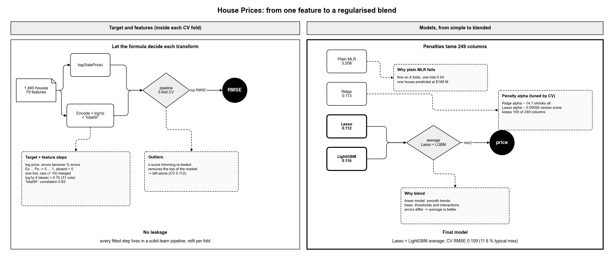
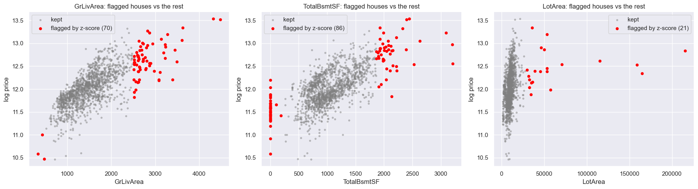
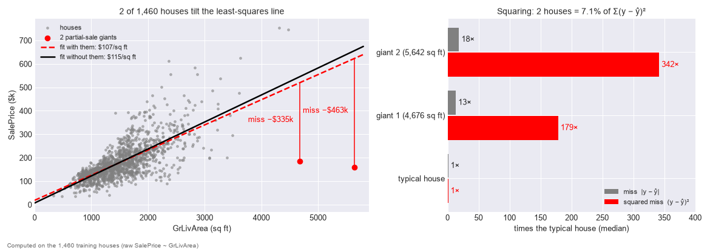
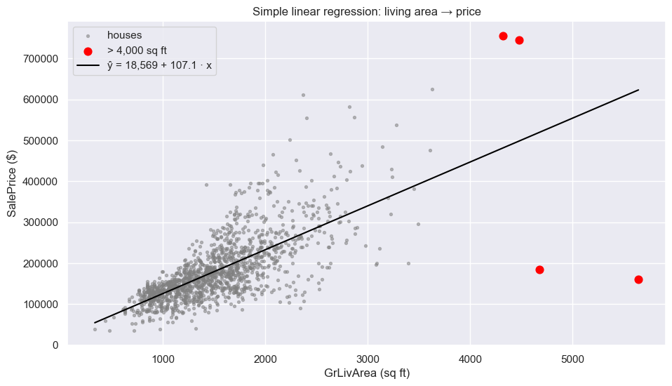
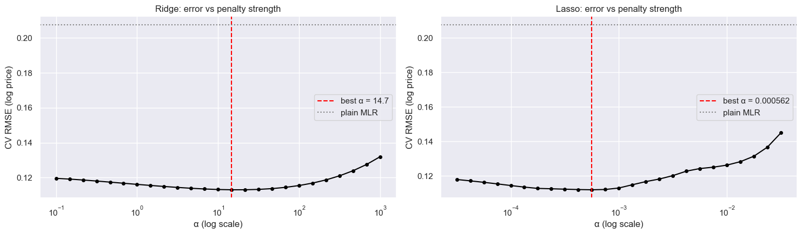
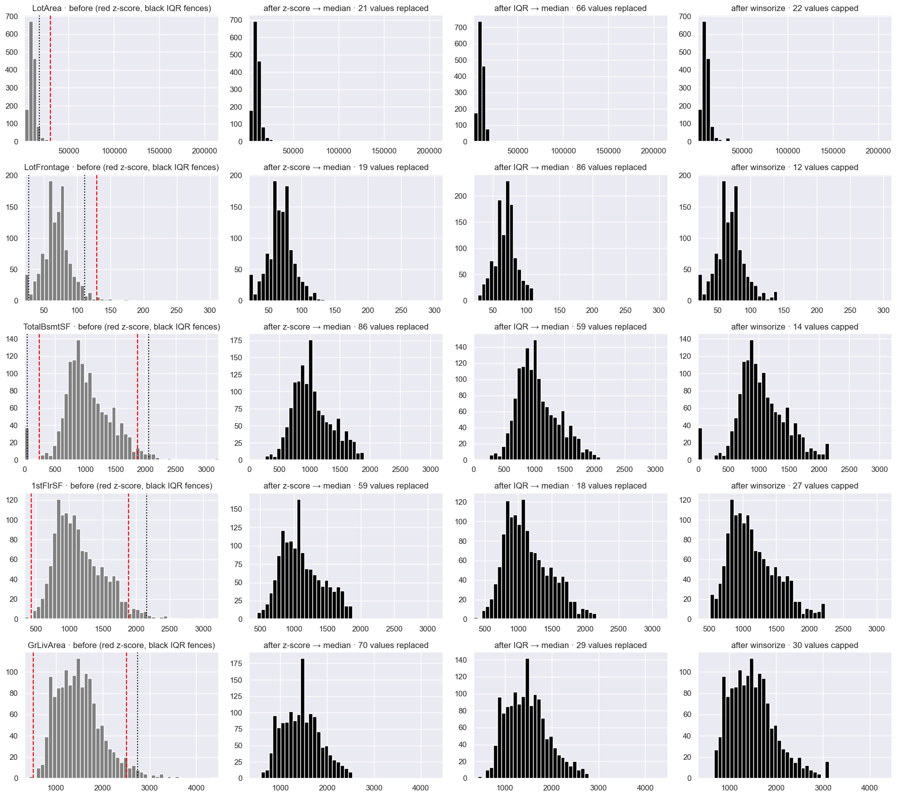
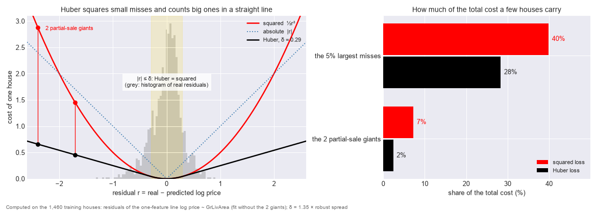
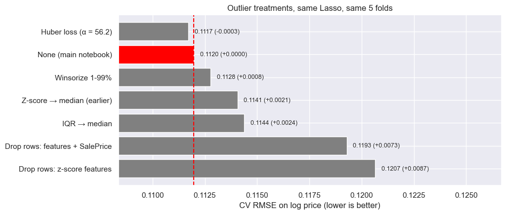

# House Prices : Linear Regression RMSE 0.109

## Objective

- **Problem** → buyers, sellers and agents price houses by gut feeling and a few "comparable" sales; a 10 % mistake on a $180k house is $18k
- **Why this repo** → build a valuation that is accurate *and* explainable, starting from one feature and adding complexity only when cross-validation says it helps
- **Real-world use** → a quick price estimate with a typical miss of ~12 %, plus the reasons (size, quality, neighbourhood) an agent can show a client

## Highlights

**Question:** what makes a house expensive in Ames?

**Answer:** size, quality and place. Total floor area is the strongest single feature (correlation 0.83 with log price); each step up the quality scale (Fair → Typical → Good → Excellent) multiplies the median price by 1.6-1.7; neighbourhood medians range from $88k to $315k.

| Lasso effect (per standard deviation or vs base) | Price change |
|---|---|
| Living area | +9 % |
| Crawford neighbourhood | +10 % |
| Commercial zoning | −24 % |

**Question:** how close can a transparent model get?

**Answer:** a typical miss of 11.6 % (CV RMSE 0.109 on log price) for a Lasso + LightGBM average; Lasso alone reaches 11.8 % and keeps only 100 of 249 columns, so its price drivers can be read directly.

**Question:** should "outliers" be removed first?

**Answer:** no. The z-score rule from the earlier version flags 178 real houses (12 %), including every house above $451,950; removing them makes the model worse (0.1207 vs 0.1120), because it deletes the top of the market, not errors.

## [1/9] Overview

- **Data** → [House Prices: Advanced Regression Techniques](https://www.kaggle.com/competitions/house-prices-advanced-regression-techniques) · 1,460 sold houses in Ames, Iowa · 79 features
- **Task** → predict `SalePrice`
- **Metric** → RMSE on log price (the competition score)
- **Notebooks** → 2 versions, same data and models
  - `house_prices_linear_regression.ipynb` → v1, data to models (README [3/9]-[7/9])
  - `house_prices_linear_regression_outliers.ipynb` → v2, v1 plus the outlier treatment section [8/9] (Kaggle title below)
- **Idea** → build linear regression from one feature to all of them, and let the formula decide each transform
- **Result** → cross-validated RMSE **0.109** (typical miss 11.6%) for a Lasso + LightGBM blend
- **Outliers** → the earlier version's z-score trimmer and 5 alternatives re-tested → none beats leaving the values alone

| Model (same 5 folds) | CV RMSE (log) | Typical miss |
|---|---|---|
| Baseline (average price) | 0.399 | 49% |
| Simple linear regression (`GrLivArea`) | 0.275 | 32% |
| Multiple linear regression (all features) | 0.208, one fold 0.54 | 23% |
| Ridge (α ≈ 14.7) | 0.113 | 12.0% |
| Lasso (α ≈ 0.00056) | 0.112 | 11.8% |
| LightGBM | 0.116 | 12.3% |
| **Blend (Lasso + LightGBM)** | **0.109** | **11.6%** |

## [2/9] Run on Kaggle

- **Title** → House Prices : Linear Regression RMSE 0.109
- **Import** → Create → Import Notebook → upload either `.ipynb` (v2 for the full story)
- **Input** → competition `house-prices-advanced-regression-techniques`
- **Accelerator** → none (CPU, a few minutes)
- **Settings** → top cell of the notebook, documented in its note
- **Safety** → `SAVE_SUBMISSION = False` → previews the predictions, writes nothing
- **Outlier trimmer** (v2) → `TRIM_OUTLIERS = None`; set `'zscore'`, `'iqr'` or `'winsorize'` to rerun every model with it

## [3/9] Data and target

- **Missing values** → 16 of the 19 gappy columns mean "the house has none" (no pool, alley, fence, garage, basement)
  - filled with `'None'` / 0 instead of dropping the column
  - only `LotFrontage`, `MasVnrArea`, `Electrical` are real unknowns → median, imputed inside each fold
- **Target** → median \$163,000, skewness 1.88 → `log(1 + price)` → skewness 0.12

## [4/9] Simple linear regression

- **Slope** → \$107 per sq ft of living area, by hand and by scikit-learn
- **Partial-sale giants** → 2 houses above 4,000 sq ft sold unfinished for \$160k-185k
  - removing them moves the slope to \$115 per sq ft
  - the 2 genuine giants (\$745k, \$755k) stay
- **Why 2 houses can tilt the line** → least squares minimises Σ(y − ŷ)²; the 2 are missed by 13× and 18× a typical house, which the square turns into 179× and 342× → 7.1 % of the total squared miss from 0.14 % of the rows

- **Gradient descent** → reaches the closed-form answer (slope 0.7252) in about 30 steps

## [5/9] Assumptions

- **Homoscedasticity** → raw-price residuals fan out (Breusch-Pagan LM 249) → log price → LM 23
- **Normality** → raw residuals skew right (0.80) → log residuals near normal, left tail of cheap houses
- **Multicollinearity** → highest VIF 5.4 (`GarageCars` vs `GarageArea`, correlation 0.88) → handled by Ridge / Lasso

## [6/9] Features

- **Ordinal scales** (`Ex … Po`) → 5 … 1, absent = 0 → `ExterQual` medians step ×1.6-1.7 per level = equal steps in log price
- **Nominal categories** → one-hot, categories rarer than 10 houses merged → 25 neighbourhoods from \$88k to \$315k
- **Skewed numerics** → `log1p` when |skewness| > 0.75 (31 columns), measured inside each fold
- **Engineered** → `TotalSF` (correlation 0.83, strongest feature), `TotalBath`, `TotalPorchSF`, age at sale, `Has…` flags
- **Leakage** → every fitted step (imputer, skew check, scaler, encoder) lives in a scikit-learn pipeline, refit per fold

## [7/9] Models

- **Plain MLR** → good on 4 folds (0.12-0.13), collapses on the 5th: one house predicted at \$187,858,413
- **Ridge / Lasso** → penalty tuned by cross-validation, fold spread 0.164 → below 0.007
  - α Σβ² (Ridge) makes big coefficients expensive, so overlapping columns share the credit; α Σ|β| (Lasso) charges every unit the same, so weak columns land on exactly 0
- **Lasso** → keeps 100 of 249 columns; strongest effects: commercial zoning −24%, Crawford +10%, living area +9% per std
- **LightGBM** → 0.116 alone, best when averaged with Lasso (0.109)
- **Largest misses** → abnormal, family and partial sales, and houses under \$65,000

## [8/9] Outlier treatment

- **Notebook** → `house_prices_linear_regression_outliers.ipynb` only
- **Earlier version** → z-score per feature (`LotArea`, `LotFrontage`, `TotalBsmtSF`, `1stFlrSF`, `GrLivArea`, `SalePrice`), flagged values → missing → imputed, before the train/test split
- **Now** → the same rule as `OutlierTrimmer` inside the pipeline (fences fitted per training fold, never on `SalePrice`), next to 5 alternatives
- **What gets flagged** → the columns are skewed, so the fences misbehave
  - `LotArea` (skewness 12.6) → z-score lower fence −8,857 sq ft → only big lots flagged (21); IQR flags 66
  - `TotalBsmtSF` → z-score flags 86, of which 37 are houses **without a basement**
  - "→ median" turns the flagged values into a spike at the median: a 4,476 sq ft \$745k house enters as ~1,430 sq ft

- **Real houses** → the 5 z-score rules flag 178 houses (12%), median \$251,646 vs \$158,000, including every house above \$451,950 → the trimmer removes the top of the market, not errors

| Treatment (Lasso, same 5 folds) | CV RMSE (log) | vs none |
|---|---|---|
| **None (main notebook)** | **0.1120** | — |
| Z-score → median (earlier version) | 0.1141 | +0.0021 |
| IQR → median | 0.1144 | +0.0024 |
| Winsorize 1-99% | 0.1128 | +0.0008 |
| Drop rows: z-score features (~142 per fold) | 0.1207 | +0.0087 |
| Drop rows: features + `SalePrice` (~157 per fold) | 0.1193 | +0.0073 |
| Huber loss (α ≈ 56, no trimming) | 0.1117 | −0.0003 (within fold noise) |

- **Huber loss** → squares misses up to δ, counts bigger ones in a straight line; on the one-feature log-price line the 2 partial-sale giants would carry 7 % of the squared cost but only 2 % of the Huber cost

- **Why** → `log1p` on skewed columns, log price and the Lasso penalty already tame the extremes → trimming only deletes information about big houses
- **Decision** → `TRIM_OUTLIERS = None`; the 2 partial-sale giants stay the only removal

## [9/9] Next steps

- **Leaderboard check** → submit and compare the public score with the cross-validated 0.109
- **Unusual sales** → flag or model abnormal / family / partial sales separately
- **Interactions** → neighbourhood × size
- **Stacking** → learned blend weights; ElasticNet, SVR, CatBoost
- **Inference** → `statsmodels` OLS on the Lasso-selected features for confidence intervals
