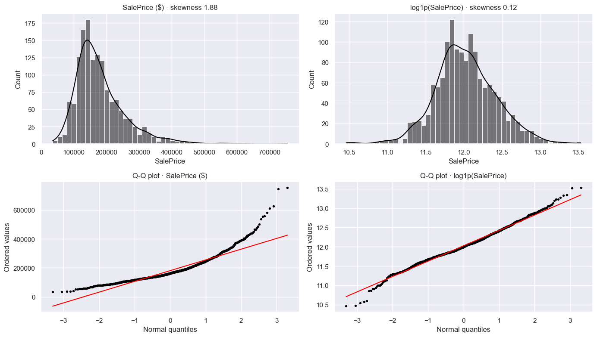
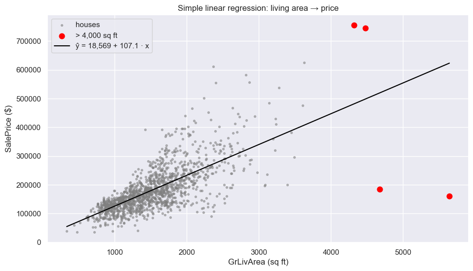
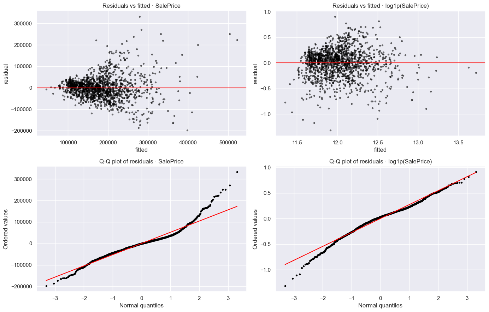
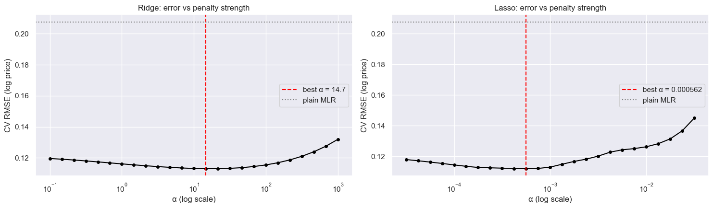
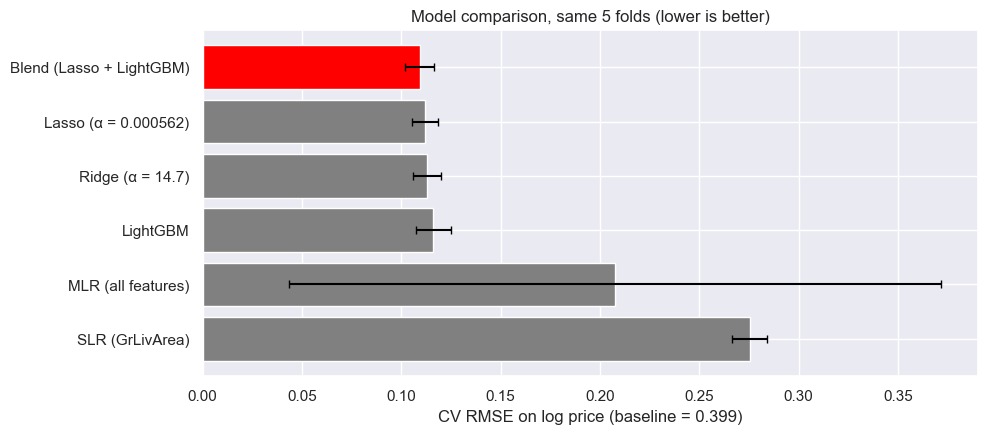

# House Prices: Linear Regression, Formula First

## [1/8] Overview

- **Data** → [House Prices: Advanced Regression Techniques](https://www.kaggle.com/competitions/house-prices-advanced-regression-techniques) · 1,460 sold houses in Ames, Iowa · 79 features
- **Task** → predict `SalePrice`
- **Metric** → RMSE on log price (the competition score)
- **Notebook** → `01_house_prices_linear_regression.ipynb`
- **Idea** → build linear regression from one feature to all of them, and let the formula decide each transform
- **Result** → cross-validated RMSE **0.109** (typical miss 11.6%) for a Lasso + LightGBM blend

| Model (same 5 folds) | CV RMSE (log) | Typical miss |
|---|---|---|
| Baseline (average price) | 0.399 | 49% |
| Simple linear regression (`GrLivArea`) | 0.275 | 32% |
| Multiple linear regression (all features) | 0.208, one fold 0.54 | 23% |
| Ridge (α ≈ 14.7) | 0.113 | 12.0% |
| Lasso (α ≈ 0.00056) | 0.112 | 11.8% |
| LightGBM | 0.116 | 12.3% |
| **Blend (Lasso + LightGBM)** | **0.109** | **11.6%** |

## [2/8] Run on Kaggle

- **Import** → Create → Import Notebook → upload the `.ipynb` (or paste its GitHub URL)
- **Input** → competition `house-prices-advanced-regression-techniques`
- **Accelerator** → none (CPU, a few minutes)
- **Settings** → top cell of the notebook, documented in its note
- **Safety** → `SAVE_SUBMISSION = False` → previews the predictions, writes nothing

## [3/8] Data and target

- **Missing values** → 16 of the 19 gappy columns mean "the house has none" (no pool, alley, fence, garage, basement)
  - filled with `'None'` / 0 instead of dropping the column
  - only `LotFrontage`, `MasVnrArea`, `Electrical` are real unknowns → median, imputed inside each fold
- **Target** → median \$163,000, skewness 1.88 → `log(1 + price)` → skewness 0.12

## [4/8] Simple linear regression

- **Slope** → \$107 per sq ft of living area, by hand and by scikit-learn
- **Partial-sale giants** → 2 houses above 4,000 sq ft sold unfinished for \$160k-185k
  - removing them moves the slope to \$115 per sq ft
  - the 2 genuine giants (\$745k, \$755k) stay
- **Gradient descent** → reaches the closed-form answer (slope 0.7252) in about 30 steps

## [5/8] Assumptions

- **Homoscedasticity** → raw-price residuals fan out (Breusch-Pagan LM 249) → log price → LM 23
- **Normality** → raw residuals skew right (0.80) → log residuals near normal, left tail of cheap houses
- **Multicollinearity** → highest VIF 5.4 (`GarageCars` vs `GarageArea`, correlation 0.88) → handled by Ridge / Lasso

## [6/8] Features

- **Ordinal scales** (`Ex … Po`) → 5 … 1, absent = 0 → `ExterQual` medians step ×1.6-1.7 per level = equal steps in log price
- **Nominal categories** → one-hot, categories rarer than 10 houses merged → 25 neighbourhoods from \$88k to \$315k
- **Skewed numerics** → `log1p` when |skewness| > 0.75 (31 columns), measured inside each fold
- **Engineered** → `TotalSF` (correlation 0.83, strongest feature), `TotalBath`, `TotalPorchSF`, age at sale, `Has…` flags
- **Leakage** → every fitted step (imputer, skew check, scaler, encoder) lives in a scikit-learn pipeline, refit per fold

## [7/8] Models

- **Plain MLR** → good on 4 folds (0.12-0.13), collapses on the 5th: one house predicted at \$187,858,413
- **Ridge / Lasso** → penalty tuned by cross-validation, fold spread 0.164 → below 0.007
- **Lasso** → keeps 100 of 249 columns; strongest effects: commercial zoning −24%, Crawford +10%, living area +9% per std
- **LightGBM** → 0.116 alone, best when averaged with Lasso (0.109)
- **Largest misses** → abnormal, family and partial sales, and houses under \$65,000

## [8/8] Next steps

- **Leaderboard check** → submit and compare the public score with the cross-validated 0.109
- **Unusual sales** → flag or model abnormal / family / partial sales separately
- **Interactions** → neighbourhood × size
- **Stacking** → learned blend weights; ElasticNet, SVR, CatBoost
- **Inference** → `statsmodels` OLS on the Lasso-selected features for confidence intervals
